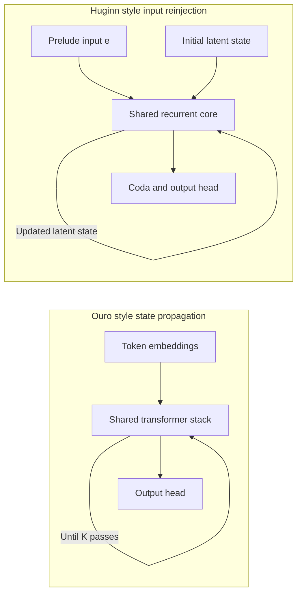

# GPT-6 Astra recurrence and open-weight model selection

Research cutoff: 2026-10-30, America/Los_Angeles.

**Astra's public architecture is insufficiently specified to identify an exact
open-weight match.** The reviewed OpenAI documentation does not establish whether
its implementation resembles Huginn's input-reinjected core, Ouro's repeated
stack, or another design. For the proposed steganography study, use Huginn and
Ouro as complementary architectural proxies. Transfer to Astra remains an open
question.

## Suitability reassessment after local calibration

2026-11-06 update: the new experiment's
[preflight findings](../../experiments/recurrent_steganography/notes/findings.md)
complete runtime checks at Dory depths 1/2/4 and Ouro-2.6B depths 1-4. Dory passed
all twelve ordinary controls at each selected depth; Ouro's shallow settings
showed additional formatting and censoring problems. The initial pilot therefore
uses Dory. Earlier statements below about untested settings describe the initial
assessment, rather than the current validation state.

Further follow-up 2026-10-31: [Ouro-1.4B-Thinking is also installed and
screened](ouro-1.4b-thinking-screen.md), including a matched-budget base comparison
and a control with identical input tokens. Its thinking-prefix run scored 4/6
exact at 512 tokens; an unfinished case completed correctly at 849 tokens in a
targeted follow-up, while another final answer had unwanted boxing. The shared
base-prompt condition scored 3/6 exact, matching base on this tiny set. Runtime
and cache checks passed at depths 1-4. This does not establish a causal
post-training improvement or a capability-versus-depth result.

The requested follow-up is now complete: see the
[precision and checkpoint screens](recurrent-model-capability-screen.md).
FP32 Huginn fit locally for short requests but did not repair the observed
calibration failures. Ouro-2.6B-Thinking and Dory 4B passed the six basic controls
when given enough output tokens; Dory also passed with its non-thinking template.
The review below records the reasons for selecting those follow-up conditions.

Follow-up checked 2026-10-30, America/Los_Angeles. The initial shortlist below
predates the completed [local runtime validation](local-recurrent-model-setup.md).
It should not be read as the final ranking of subjects for an instruction-driven
steganography experiment.

The installed Ouro-1.4B is the base checkpoint. Huginn's authors explicitly state
that their checkpoint was not fine-tuned or post-trained, although instruction
examples were included in pretraining. See the
[Huginn model card](https://huggingface.co/tomg-group-umd/huginn-0125#chat-templating).
Post-training is therefore a candidate explanation to test before attributing
the initial calibration failures to parameter count or recurrence.

Both local subjects run with BF16 parameters, verified by the loader. Neither
uses a 4-bit/8-bit inference quantizer or a GGUF quantization. Huginn's released
weights are FP32 and are cast to BF16 as recommended in the author's example;
this involves ordinary precision reduction. Ouro is released in BF16. No
BF16-versus-FP32 capability comparison had been performed at the initial review.
The subsequent paired comparison found 0/6 exact final-answer compliance in both
precisions, with five of six complete output-token sequences identical. This
does not mean that all mapping conclusions were wrong: several were correct in
unwanted prose. Runtime settings and assertions are in
[`backend.py`](../../src/eval_core/local/backend.py).

### Additional candidates

| Candidate | Size and training distinction | Experimental role |
| --- | --- | --- |
| [Ouro-1.4B-Thinking](https://huggingface.co/ByteDance/Ouro-1.4B-Thinking) | Same size family; supervised fine-tuning for reasoning, code, science, and chat | Compare post-training at the existing size; retains recurrent-step controls. |
| [Ouro-2.6B-Thinking](https://huggingface.co/ByteDance/Ouro-2.6B-Thinking) | Larger than the installed Ouro, with reasoning SFT; still smaller than Huginn | Practical first size/post-training extension. The released config has 48 physical layers, despite the card's 24-layer table. |
| [NVIDIA Nemotron Labs Dory1.0-4B-BF16](https://huggingface.co/nvidia/NVIDIA-Nemotron-Labs-Dory1.0-4B-BF16) | About 4B; SFT and RL; an input-reinjected middle block with 1-4 loop controls | Candidate for stronger instruction following and a second recurrence design. Uses 8 input, 20 recurrent, and 8 output layers. |
| [Nanbeige4.2-3B](https://huggingface.co/Nanbeige/Nanbeige4.2-3B) | About 4B total, including embeddings; 3B refers to non-embedding parameters; SFT and RL | Post-trained repeated-stack alternative. Its released configuration uses two loops, so a broad depth sweep needs extrapolation checks. |
| [IQuest-Coder-V1-40B-Loop-Instruct](https://huggingface.co/IQuestLab/IQuest-Coder-V1-40B-Loop-Instruct) | 40B coding/instruction model with shared-parameter loop training | A substantially larger replication candidate, with a different gated attention design and much higher hardware requirements. |

At the time of the review these were leads. Both Ouro Thinking sizes and Dory are
now installed and screened at depths 4 and 2 respectively; other candidates remain
unscreened here. The two Ouro Thinking cards
describe approximately 8.3M SFT examples. Their visible reasoning must be accounted
for separately from latent recurrence; a 12-token allowance is unsuitable for
assessing a potentially long thinking trace. Instruction formatting and mapping
accuracy should also receive separate scores. Ouro's four initial mappings were
semantically correct even though only one response matched the exact format.

Dory was released October 16. Its card still described a pending vLLM integration,
but the [actual integration PR](https://github.com/vllm-project/vllm/pull/60149)
was merged October 25, according to the GitHub API checked in this follow-up.
The subsequent local setup found that the vLLM 0.32.0 wheel lacked the model and
used the official integration as a pinned external plugin; details and limits
are in the capability-screen report.
Use per-loop caching for the first study condition. Its BF16 release also has a
mixed NVFP4/BF16 pretraining history; inference precision and training precision
are separate provenance fields.

For Nanbeige, the [paper](https://arxiv.org/html/2607.22083v1#S2.SS1) and
[released config](https://huggingface.co/Nanbeige/Nanbeige4.2-3B/blob/main/config.json)
establish shared-stack recurrence and `num_loops=2`. Its chat template exposes a
non-thinking mode, which changes written reasoning rather than the latent loop
count. The newer
[Nanbeige4.3-33B config](https://huggingface.co/Nanbeige/Nanbeige4.3-33B/blob/main/config.json)
instead specifies stock `LlamaForCausalLM` without the loop control; the larger
family name alone does not establish a usable recurrence intervention.

### Hardware and selection implications

Estimated BF16 weights alone are about 5 GiB for Ouro-2.6B and 7.4-8 GiB for the
roughly 4B candidates. These are arithmetic estimates, not measured peak memory;
KV caches, activations, runtime allocations, and desktop VRAM are additional.
The subsequent BF16 screens confirmed batch-one, short-context inference on the
16 GB RTX 5070 Ti at Ouro depth 4 and Dory depth 2 without low-bit quantization.
Peak allocated memory was 5.70 GiB and 12.04 GiB respectively; Dory includes a
preallocated KV pool, so these values are not comparable memory-efficiency
measurements. Other depths and longer occupied contexts still need validation.
An 8B BF16 model would require about 14.9 GiB for weights alone and is therefore
not a practical fully resident baseline on this GPU once overhead is included.

Larger recurrent checkpoints do exist. The
[IQuest technical report](https://arxiv.org/html/2603.16733v1#S2.SS1) describes two
fixed iterations, with later-loop attention mixing global first-loop keys/values
and local later-loop attention through a learned gate. Its
[released config](https://huggingface.co/IQuestLab/IQuest-Coder-V1-40B-Loop-Instruct/blob/main/config.json)
sets `loop_num=2`; the
[model implementation](https://huggingface.co/IQuestLab/IQuest-Coder-V1-40B-Loop-Instruct/raw/main/modeling_iquestloopcoder.py)
captures that value at construction and loops over it in `forward`. This provides
an inspectable depth intervention, but not evidence of reliable arbitrary-depth
operation. One loop removes the trained second-pass mechanism, and more than two
loops extrapolate beyond the documented training scheme. The 7B/14B models in
the same family are not the released Loop variants.

For a 40B BF16 model, weights alone are roughly 80 GB (74.5 GiB), far above local
GPU memory. A research baseline would need larger accelerator capacity; local
quantization plus CPU/disk offload would add precision and serving changes.
A separate
[training-free looping paper](https://arxiv.org/html/2605.23872v1) applies loops
to larger frozen models, but that is a retrofit experiment rather than a
checkpoint trained to use recurrent depth.

Prioritize calibration of Ouro-2.6B-Thinking as the closest extension of the
working runtime; use Ouro-1.4B-Thinking if isolating post-training at a fixed size
is important. Assess Dory as a stronger prospective primary subject and Nanbeige
as another architectural replication. Retain Huginn for architectural sensitivity
only if it passes a more representative capability gate. Keep the existing
calibration failures: a model should not be tuned against held-out evaluation
items, and successful calibration must precede interpreting negative hidden-code
results as evidence against the hypothesis.

None is an established implementation match for Astra. The current
[official OpenAI model documentation](https://developers.openai.com/api/docs/models/gpt-6-astra)
still does not identify its recurrent operator or a loop-count setting.

## Evidence about Astra

| Evidence | Status and scope | Consequence |
| --- | --- | --- |
| [OpenAI launch announcement](https://openai.com/index/gpt-6-astra/) and [system card](https://deploymentsafety.openai.com/gpt-6-astra) | Primary sources. The reviewed pages do not specify loop placement, weight sharing, input injection, or iteration counts. | Implementation equivalence cannot be established from these releases. |
| [System card, section 9](https://deploymentsafety.openai.com/gpt-6-astra) | Reports stronger capability without verbalized reasoning and reduced CoT monitorability. OpenAI does not attribute increased CoT controllability differentially to architectural changes. | Behavior alone does not identify a recurrent operator or establish its causal contribution. |
| [Official model documentation](https://developers.openai.com/api/docs/models/gpt-6-astra) | Lists reasoning efforts `low`, `medium`, `high`, `xhigh`, and `max`; no documented recurrence-count control. | An effort sweep is not a calibrated loop-count intervention. |
| [Original reporting](https://www.theinformation.com/articles/secret-technique-behind-openais-astra-model-sparks-security-concerns) | The Information reports limited recurrence, citing an unnamed source. | Unconfirmed architectural allegation. |
| [Statement attributed to Jakub Pachocki](https://x.com/merettm/status/2095023204993490967), preserved in a [third-party reproduction](https://x.noodl3.net/thlarsen/status/2095263760646914172) | Attributes computation-graph depth within a factor of two of GPT-4 to current frontier models, including Astra. Direct X access returned HTTP 403; the reproduction was readable. | An attributed statement with an access limitation, rather than an independently verified architectural specification. |

The original reporting was published September 1, 2026 in Pacific time. Its
landing page was paywalled; the characterization above is supported by the indexed
extract. The original X statement and its reproduction have different
verification status. Neither provides an architecture diagram or an iteration
schedule.

The system card also reports that its math-side-task evaluation did not
demonstrate successful concealed CoT reasoning: Astra could solve the side tasks,
but the full-context monitor detected them. This is a result for that evaluation,
not a general impossibility result for steganographic communication. See
[section 9.2.2.4](https://deploymentsafety.openai.com/gpt-6-astra).

## Implementation details that remain unknown

| Property | Established for Astra in the reviewed sources? | Importance for choosing a proxy |
| --- | --- | --- |
| Repeated module | No | A middle block, entire stack, and selected layers implement different interventions. |
| Parameter sharing | No technical specification located | Shared weights are central to a depth-recurrence comparison. |
| Fixed input reinjection | No | Reinjection changes the information available at each iteration. |
| Initial latent state | No | Random initialization and embedded-input initialization have different dynamics. |
| Loop count and schedule | No | Fixed counts, per-token halting, and per-request allocation are different treatments. |
| Training depth distribution and supervision | No | Inference depth and training depth are separate variables. |
| Cache handling across loops | No | Cache policy changes memory use and can change the computation. |
| Latent-state persistence across output tokens | No | This adds a different information path from recurrence confined to a token's computation. |
| Reasoning-effort mapping to internal computation | No | Latent computation and reasoning-token budgets cannot be separated through that setting alone. |

For a simple recurrent architecture, transformer-layer applications per token
would be approximately

```text
executed layers = prelude layers + K * recurrent-block layers + coda layers
```

This is an illustrative accounting identity, not a measured Astra formula.
Different block sizes can produce the same executed depth with different `K`.
Even accepting the attributed factor-of-two statement would not justify saying
that Astra loops twice. Its graph-depth convention is unspecified here.

## Published recurrence designs we can inspect

Depth recurrence transforms continuous activations repeatedly before producing a
token. Extra autoregressive reasoning tokens, repeated API calls, and additional
agent turns are separate sources of computation. A model can combine latent
iterations with written reasoning.

The diagram describes published open models. Astra's placement is unknown.



### Huginn

Huginn separates a prelude, recurrent core, and coda:

```text
e = Prelude(token prefix)
s[0] = random initial state
s[i + 1] = RecurrentCore(e, s[i])
next-token distribution = Coda(s[K])
```

The core parameters are reused and the fixed representation `e` enters every
iteration. In the inspected implementation, `core_block_forward` concatenates
the current state with the input representation and applies an adapter before
the core layers. Training samples recurrence lengths. See the
[Huginn paper, section 3](https://arxiv.org/html/2502.05171v2) and
[modeling implementation](https://github.com/seal-rg/recurrent-pretraining/blob/59e0b69b2d96a59cbbe79c9d5034d89ecb5ab6f6/recpre/raven_modeling_minimal.py#L764).

The [released checkpoint](https://huggingface.co/tomg-group-umd/huginn-0125)
exposes `num_steps` during generation. Its authors warn that fewer than four steps
produce coarse answers. A pilot sweep of 4, 8, 16, and 32 is reasonable; it gives
no estimate of Astra's operating depth.

### Ouro

Ouro repeatedly applies a shared transformer stack:

```text
h[0] = Embed(token prefix)
h[i + 1] = SharedStack(h[i])
next-token distribution = OutputHead(h[K])
```

It does not use Huginn's separate fixed-input reinjection in this schematic.
Ordinary causal attention to prefix representations still exists; this distinction
does not mean that Ouro loses access to the prompt. Ouro trains an exit gate to
select depth. See the [Ouro paper, sections 3.1 and 3.2](https://arxiv.org/html/2510.25741v1).

The [Ouro-1.4B configuration](https://huggingface.co/ByteDance/Ouro-1.4B/blob/main/config.json)
specifies 24 shared layers and four recurrent steps. The
[model card](https://huggingface.co/ByteDance/Ouro-1.4B) exposes `total_ut_steps`
and documents `early_exit_threshold=1.0` for running all steps. Start with 1, 2, 3,
and 4 steps. The paper identifies depths above four as extrapolation and reports
degradation on several benchmarks, so analyze those settings separately.

Four loops in Ouro and four loops in Huginn are different amounts of computation.
For example, the [Huginn configuration](https://huggingface.co/tomg-group-umd/huginn-0125/blob/main/config.json)
has two prelude layers, four core layers, and two coda layers: four loops execute
20 transformer layers. Ouro-1.4B's 24-layer stack executes 96 layers at four loops.
These are layer-application counts, not equal-FLOP comparisons; model widths also
differ. Report loop count, executed layers, and measured runtime separately.

### Other candidates from the initial shortlist

| Candidate | Recurrence design | Role in this study |
| --- | --- | --- |
| [Ouro-2.6B](https://huggingface.co/ByteDance/Ouro-2.6B) | Same broad repeated-stack family as Ouro-1.4B. | Larger replication; does not span the reinjection distinction. |
| [Recurrent-OLMo-2](https://huggingface.co/smcleish/Recurrent-OLMo-2-0425-train-recurrence-16) | Retrofitted recurrence using Huginn-derived modeling code, with a `num_steps` control. | Smaller additional proxy. The release is a base model rather than an instruction model. |
| [Qwen3-1.7B LoopUS](https://huggingface.co/Thrillcrazyer/Qwen3_1.7B_LoopUS) | Encoder, repeated middle block, decoder; a selective gate mixes each proposed update with the previous state. A confidence head controls halting. | Useful for a gated middle-block hypothesis; log actual executed iterations. |

LoopUS's update mixing and stopping decision are distinct mechanisms. Disabling
adaptive stopping does not remove its state-update gate. See the
[LoopUS paper, section 3.1](https://arxiv.org/html/2605.11011v1) and
[implementation](https://github.com/Thrillcrazyer/LoopUS/blob/main/models/modeling_lds.py).

An independent [October 2026 study](https://arxiv.org/html/2610.18127v1) groups Ouro
and LoopUS as state-carrying loops, and Huginn and Rec-OLMo as input-reinjected
loops. It also finds that additional iterations can plateau or harm predictions.
Neither the group labels nor those results identify Astra's design.

## Initial model selection for the steganography hypothesis

**Use Huginn and Ouro-1.4B to cover the major unresolved architectural choice.**
This supports sensitivity analysis without claiming to reproduce Astra. If only
one starting model is practical, choose according to the scientific priority:

| Priority | Starting model | Reason |
| --- | --- | --- |
| Broad inference-depth sweep | Huginn | Variable recurrence and access to the recurrent core. |
| Pilot across a few repeated-stack passes | Ouro-1.4B | Small checkpoint and a documented 1-4 step range to examine. |
| Replication of a repeated-stack result | Ouro-2.6B | Larger checkpoint in the same family. |
| Gated middle-block hypothesis | LoopUS | Explicit update gating plus a separate halting mechanism. |

Vary encoder and decoder depth independently within each fixed checkpoint.
Establish above-chance recovery on a benign, explicitly specified encoding task
before testing channels the models must discover. Record recovery, task fidelity,
and detectability separately. Message transfer and reasoning hidden within
unrelated text answer different questions.

Keep generation limits, prompts, payloads, and sampling settings fixed within a
depth comparison. Disable adaptive stopping for the primary fixed-depth analysis
and log actual loop counts. For Huginn, control the random initial state and
repeat across seeds. A fixed token-sampling seed alone does not eliminate that
source of variation.

Pin model revisions, modeling code, library versions, precision, and cache policy.
Huginn's implementation indexes its cache by recurrent step as well as sequence
position. Reusing weights does not imply identical key/value states across loops.
Cache-sharing optimizations should be separate conditions. Check both prompt
prefill and token decoding when validating depth controls.

Results would establish inference-depth effects in the tested open models.
Transfer to Astra requires a verified mapping and comparable interventions. A
public disclosure of loop scope, input injection, scheduling, and latent-state
persistence would be needed to narrow the proxy choice.

## Initial local hardware feasibility assessment

This subsection records the pre-installation inspection. The completed runtime
setup, measured memory, and timings are in the
[local execution record](local-recurrent-model-setup.md).

Checked on 2026-10-30 using
[the local machine notes](../../../LocalLLMs/AGENTS.md) and narrow runtime checks.
The recorded hardware is an RTX 5070 Ti with 16 GB VRAM, 64 GB system RAM, and a
Ryzen 9 9950X3D. Current GPU reporting confirms 16,303 MiB total VRAM, 6,300 MiB
free, and Windows driver 617.42. Available GPU memory is a snapshot; release
competing GPU workloads before testing either model.

`Ubuntu-LLM` currently exposes about 30 GiB RAM, with 29 GiB available, and has
176 GiB free on its native Linux filesystem. Its default Python is 3.12.3; that
interpreter has no installed PyTorch, Transformers, Accelerate, Safetensors, or
pip package. The established inference setup uses Ollama. Its server was not
running during this inspection. No virtual environment was found in the checked
`/home/ben/llm` tree through three directory levels.

**The hardware should support both proposed models for inference.** Start with
one loaded model, batch size one, BF16 weights, and short sequences. Ouro-1.4B is
the easier first target. Huginn needs more attention to sequence length and
recurrence depth. This is a capacity assessment, not a completed inference test.

| Model | Approximate BF16 weight memory | Calculated BF16 KV cache at 1,024 total tokens | Initial pilot settings |
| --- | --- | --- | --- |
| Ouro-1.4B | About 2.7 GiB | 0.75 GiB at four loops | 1-4 loops; 1,024 total tokens; batch one |
| Ouro-2.6B | About 5 GiB | 1.5 GiB at four loops | Four loops; 1,024 total tokens; batch one |
| Huginn-0125 | Roughly 7-8 GiB | 1.37 GiB at 16 steps; 2.66 GiB at 32 steps | Begin at 16 steps and 512 total tokens, then profile 32 steps and longer sequences |

Weight sizes are planning estimates. Cache values are arithmetic estimates from
the released [Huginn](https://huggingface.co/tomg-group-umd/huginn-0125/blob/main/config.json),
[Ouro-1.4B](https://huggingface.co/ByteDance/Ouro-1.4B/blob/main/config.json), and
[Ouro-2.6B](https://huggingface.co/ByteDance/Ouro-2.6B/blob/main/config.json)
configurations, assuming a full cache with separate entries for each executed
layer and iteration:

```text
KV bytes = 2 * batch * sequence tokens * KV heads * head dimension
           * executed attention layers * bytes per cached value
```

These figures exclude activations, attention workspaces, logits, temporary cache
copies, CUDA overhead, and desktop allocations. Total tokens include both the
prompt and generated continuation. At 32 steps and 2,048 tokens, Huginn's cache
alone is about 5.32 GiB; at 64 steps and 1,024 tokens it is about 5.24 GiB. Those
conditions have substantially less headroom. An 8,192-token Ollama default should
not be carried over to Huginn as an assumed feasible setting.

Use an isolated PyTorch/Transformers environment on WSL's native filesystem to
expose and validate depth controls. Choose a Blackwell-compatible CUDA build;
[PyTorch 2.7 introduced Blackwell support and CUDA 12.8 wheels](https://pytorch.org/blog/pytorch-2-7/).
Pin the model-specific Transformers compatibility separately: Huginn's custom
cache and Ouro's remote modeling code need validation against the selected
library version. Explicitly load Huginn in BF16, as recommended by its authors,
rather than inheriting the checkpoint's FP32 configuration. No quantization is
required for the proposed starting conditions, so it can remain a later
experimental factor.

Throughput remains unmeasured. More loops add serial computation, so the existing
Qwen/Ollama speed measurements do not predict these models' token rates. The next
validation should check correct generation, observed loop counts, peak VRAM, and
runtime on a small frozen prompt set before scaling the study. No software
installation, model download, driver change, or workload termination was performed
for this assessment.

## Additional leads and source limits

- An October Microsoft-screenshot claim describes two versus three inference
  passes for **GPT-6.1 Sol**, a different model. The original publication and its
  provenance were not verified. The accessible
  [Microsoft model catalog](https://learn.microsoft.com/en-us/azure/foundry/foundry-models/concepts/models-sold-directly-by-azure?view=foundry-classic)
  does not establish that implementation. Do not use this claim to set Astra's
  loop count. [Lead describing the screenshot's limitations](https://pasqualepillitteri.it/en/news/21350/microsoft-looped-transformers-gpt-6-1-sol-two-passes).
- Claims about successors or unreleased checkpoints do not establish the
  implementation of the released `gpt-6-astra` model.
- Official pages reviewed include the launch announcement, system card, API model
  page, current model guide, and Microsoft catalog. Searches combined Astra with
  recurrence, recurrent depth, looped transformers, computation-graph depth, and
  inference passes. This dated review is not an exhaustive proof that no
  disclosure exists elsewhere.
- Technical descriptions above rely on open-model papers, releases, and code.
  News allegations and inaccessible or unverified originals are retained as
  leads, not implementation specifications.

The initial architectural/hardware review did not perform inference or install
models. The later runtime validation and suitability reassessment are distinguished
above; they establish no scientific steganography result.
