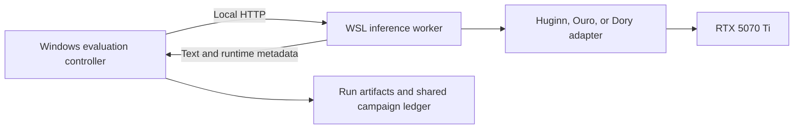

# Local setup for recurrent-depth experiments

Implemented 2026-10-30 (2026-10-31 UTC). Subjects: `tomg-group-umd/huginn-0125`,
`ByteDance/Ouro-1.4B`, `ByteDance/Ouro-1.4B-Thinking`, `ByteDance/Ouro-2.6B-Thinking`, and
`nvidia/NVIDIA-Nemotron-Labs-Dory1.0-4B-BF16`.
The architecture and hardware assessment is recorded in
[the Astra recurrence research note](astra-recurrent-depth.md).
The [Ouro-1.4B-Thinking follow-up](ouro-1.4b-thinking-screen.md) records the latest
checkpoint addition and its matched-budget base comparison.
The [2026-11-06 preflight](../../experiments/recurrent_steganography/notes/findings.md)
completes runtime checks across the intended Dory and Ouro-2.6B depths and records
broader ordinary-task controls for the new experiment.

Use the existing `Ubuntu-LLM` WSL distribution, three isolated Python environments,
and a small local inference worker. Keep experiment source, protocols, and
authoritative run records in the evaluation repository. Validate generation and
depth controls before freezing dependencies or running a scientific pilot.

## Runtime layout

```text
G:\Evals\                           Experiment source and authoritative results
  docs/research/                     Research and setup decisions
  artifacts/runs/<experiment>/        Generated evidence, ignored by Git

/home/ben/llm/recurrent/              Native WSL filesystem
  envs/huginn/                        Huginn Python environment
  envs/ouro/                          Ouro Python environment
  envs/dory/                          Dory vLLM environment
  cache/huggingface/                  Shared immutable model snapshots
  logs/                              Worker diagnostics
  benchmarks/                        Runtime validation measurements
```

Create and maintain setup scripts and dependency manifests as repository source;
keep installed packages and weights on WSL's native filesystem. This follows the
machine's established storage preference and avoids placing weights in Git. Plan
for approximately 40-60 GiB of free disk space for the initial two models,
CUDA-enabled Python packages, and download caches. That is a planning allowance,
not a measured installation size. The completed installation measured about 25 GiB
with `du -sh /home/ben/llm/recurrent`; shared package hardlinks are counted once.
That measurement predates the added Thinking weights and Dory runtime. After
the additions, the native WSL filesystem had 128.87 GiB free; its capacity is
250.9 GiB and it also contains the pre-existing local-LLM installation.

## Environments and model revisions

The Huginn and Ouro environments use Python 3.12.3 and PyTorch 2.9.1+cu128 with CUDA
12.8 on the RTX 5070 Ti (compute capability 12.0). Both passed a GPU BF16 matrix
operation before model loading. Transformers is 4.51.3 for Huginn and 4.57.1 for
Ouro, including both Thinking sizes, which reuse that environment. These CUDA
wheels come from the [official PyTorch index](https://download.pytorch.org/whl/cu128).

Dory uses a separate Python 3.12.3 environment with vLLM 0.32.0, PyTorch 2.13.0
(CUDA 13.0), Transformers 5.19.0, and Hugging Face Hub 2.4.0. The wheel does not
include Dory, so the official model implementation is registered through an
external plugin. Its pinned upstream commit, file hashes, retained license, and
single import-path adaptation are documented in
[`dory-vendor.json`](../../local_models/dory-vendor.json). Eager execution and
Triton attention worked on this GPU without changing its driver.

Each environment needs PyTorch, Transformers, Accelerate, Safetensors,
Hugging Face Hub, and the local worker's small transport dependencies. Install
inference dependencies only. Dory additionally requires the serving engine and
Ubuntu compiler prerequisites described below.

Separate complete dependency locks are stored in
[`local_models/locks`](../../local_models/locks), with distribution hashes. Each
Huginn/Ouro lock contains 43 packages; the Dory third-party lock contains 198.
The local Dory plugin is installed separately from this checkout in editable
mode. Huginn and all three Ouro checkpoints use custom
modeling code, and their Transformers compatibility can differ. The
[Ouro model card](https://huggingface.co/ByteDance/Ouro-1.4B) recommends 4.54.1 or
earlier in its quick start while also acknowledging a later-version cache fix.
The pinned current Ouro code imports newer cache/masking interfaces, and passed
locally on 4.57.1. Huginn passed independently on 4.51.3.

Full model/tokenizer/code revisions and reviewed Python source hashes are in
[`profiles.json`](../../src/eval_core/local/profiles.json). The loader checks those
source hashes before allowing `trust_remote_code=True` and loads offline from the
pinned snapshots. Imports, forward/cache paths, and potentially executable or
filesystem/network calls were inspected. No Huginn/Ouro source patch was needed.
Dory verifies its vendored source hashes and does not enable remote code.
Responses record local adapter hashes and runtime versions; dependency locks
retain the full package identities and hashes.

## Controller and worker boundary



Run one worker and one loaded model at a time. A single local port, proposed as
`127.0.0.1:8010`, is sufficient. Validate Windows-to-WSL connectivity using
[WSL localhost forwarding](https://learn.microsoft.com/en-us/windows/wsl/networking).
Keep the listener local. Queue requests and use a GPU ownership lock to prevent
accidentally launching multiple model workers together.

The built-in provider factory now supports `provider="local"` through the
[dedicated adapter](../../src/eval_core/providers/local.py). The controller and
existing campaign SQLite ledger stay on Windows. The worker never opens that
ledger through the WSL mount. Zero-dollar calls retain ordinary reservations and
settlement records; paid-call accounting remains covered by regression tests.

The worker should expose health/capability inspection, exact token counting, and
generation. Requests identify the model profile, seed, prompt/template version,
and output limit. Responses include the resolved model revision, token counts,
stop reason, requested depth, observed depth, timings, and peak memory. Unsupported
controls or oversized contexts should fail explicitly. Never silently reduce
depth or truncate a prompt to make it fit.

Local subject calls have zero provider API charge; record synchronized inference
wall time separately.
Any paid judge calls should continue using the shared campaign ledger and their
own configured spending limits. The local provider must report real tokenizer
counts and verified model identity rather than pretending a local run is a mock.

## Recurrence controls

| Subject | Planned primary depth settings | Required handling |
| --- | --- | --- |
| Huginn-0125 | 4, 8, 16, 32 | Pass `num_steps` to generation; control latent initialization and sampling seeds. |
| Ouro-1.4B | 1, 2, 3, 4 | Set `total_ut_steps`, use a fixed-depth output policy, and verify every loop executes. |
| Ouro-1.4B-Thinking | 1, 2, 3, 4 | Same construction-time control; the supplied thinking template adds a `<think>` prefix. |
| Ouro-2.6B-Thinking | 1, 2, 3, 4 | Same construction-time control; capability screen completed at 4 only. |
| Dory 4B | 1, 2, 4 | Set `n_recurrent_loops` before construction; use per-loop KV caches. Capability screen completed at 2 only. |

Huginn's authors specifically warn that `num_steps` must not be placed inside
`GenerationConfig`; it belongs in the model/generation arguments. Its cache is
also model-specific. See the [Huginn model card](https://huggingface.co/tomg-group-umd/huginn-0125).

The inspected [Ouro implementation](https://huggingface.co/ByteDance/Ouro-1.4B/blob/main/modeling_ouro.py)
captures `total_ut_steps` as an instance attribute during construction, while cache
sizing separately consults the configuration. Changing only the configuration
after loading can therefore leave the execution loop and cache inconsistent.
For initial validation, configure depth before model construction and restart the
worker between depth batches. A later adapter supporting depth changes within a
process must update all relevant state and pass the same loop-count checks.

Instrument actual recurrent block executions in both prompt prefill and decoding.
Record the number of forward passes as well as iterations per forward pass;
generation length changes the total number of block executions. This distinguishes
a functioning depth intervention from a configuration field that is ignored.

Keep model weights loaded between requests, but initialize a fresh request cache
and latent state for every trial. Disable dropout with evaluation mode and use
inference mode. Disable adaptive halting, cache-sharing approximations, and
cross-request state reuse in the primary reference condition. Record precision
and attention backend. Use BF16 initially so quantization does not become an
additional experimental factor.

Dory's config counts attention/MLP sublayers: 16 input, 40 recurrent, and 16
output sublayers correspond to 8/20/8 attention-plus-MLP layer pairs. Hooks count
the first recurrent sublayer once per loop. Its final adapter disables async
scheduling and requires one measured forward per generated token. Switching the
chat template's written-thinking option does not change the latent loop count.

## Resource profiles and acceptance checks

Begin with batch size one. For integration checks, cap Huginn at 512 total tokens
and Ouro at 1,024 total tokens, including the generated continuation. Raise these
limits only after profiling peak memory. Warmup and model-loading time must be
separate from steady-state generation timing.

The added Ouro Thinking and Dory profiles allow 2,048 total tokens. Huginn's
paired FP32 diagnostic used a smaller 128-token total ceiling and 64-token
output allowance, reaching 14.59 GiB peak allocation fully on the GPU. This
does not validate the ordinary 512-token profile in FP32. Detailed conditions
and capability results are in the
[follow-up screen](recurrent-model-capability-screen.md).

Before the scientific pilot, require:

1. GPU visibility, BF16 operations, and full intended GPU placement in each environment.
2. Successful generation and correct EOS/output-limit accounting for each model.
3. Verified loop counts at every supported depth, including both prefill and decoding.
4. Repeat runs under fixed seeds, plus checks for cache or latent-state leakage across requests.
5. Peak VRAM, wall time, and generation throughput for the initial profiles.
6. Correct artifact records, model identity, token counts, and error propagation through the local provider.

Generation success establishes integration, not steganographic ability. After
these checks, run a benign encoding/recovery calibration before freezing the new
experiment's scientific protocol.

For the original Huginn/Ouro-1.4B setup, all eight depth
settings passed generation, actual-loop instrumentation, request isolation,
output-limit, and cached/full-prefix greedy-token checks. These cache checks cover
three continuation positions, not exhaustive numerical equivalence. The largest
depth of each model also passed its configured context boundary. Both models
worked through Windows-to-WSL HTTP and real `RunSession` accounting.
All added checkpoints have working local generation and Windows-to-WSL probes.
Ouro-1.4B-Thinking additionally passed runtime/cache checks at depths 1-4 and its
2,048-token boundary. The 2026-11-06 preflight also passed runtime/cache checks
for Ouro-2.6B-Thinking at depths 1-4 and Dory at 1, 2, and 4, including their
2,048-token boundaries. Its twelve ordinary-task controls per depth are reported
in the new experiment's preparation findings and do not establish steganographic
competence.

## Running the installed models

From a PowerShell terminal at `G:\Evals`, start one worker in the foreground:

```powershell
.\tools\local_models\serve.ps1 -Profile ouro -Depth 4
# Alternatively, after stopping Ouro:
.\tools\local_models\serve.ps1 -Profile huginn -Depth 32
# Post-trained alternatives, one at a time:
.\tools\local_models\serve.ps1 -Profile ouro-1.4b-thinking -Depth 4
.\tools\local_models\serve.ps1 -Profile ouro-2.6b-thinking -Depth 4
.\tools\local_models\serve.ps1 -Profile dory -Depth 2
```

Wait for the JSON `listening` message. In a second terminal, exercise the selected
worker and write a real zero-charge integration record:

```powershell
.\.venv\Scripts\python.exe -B tools/local_models/probe.py --profile ouro --depth 4
# Use --profile huginn --depth 32 when Huginn is loaded.
# For the post-trained alternatives, select the matching running worker:
.\.venv\Scripts\python.exe -B tools/local_models/probe.py --profile ouro-1.4b-thinking --depth 4 --prompt-format native-chat-thinking-v1 --max-output-tokens 512
.\.venv\Scripts\python.exe -B tools/local_models/probe.py --profile ouro-2.6b-thinking --depth 4 --prompt-format native-chat-thinking-v1 --max-output-tokens 512
.\.venv\Scripts\python.exe -B tools/local_models/probe.py --profile dory --depth 2 --prompt-format native-chat-no-thinking-v1 --max-output-tokens 128
.\tools\local_models\stop.ps1
```

Ctrl+C in the server terminal also stops the worker. The stop helper verifies
that the recorded PID belongs to a recurrent model server before signaling it.
The launcher was exercised, and a second worker was rejected by the GPU lock.
No worker is left running after setup validation.

Depth is fixed at worker startup. Stop and restart for the next depth batch.
The worker requires at least 5 GiB free VRAM for 1.4B Ouro checkpoints, 7 GiB for 2.6B Ouro Thinking,
or 11 GiB for Huginn/Dory before
loading; insufficient memory produces an explicit error. The default endpoint is
`http://127.0.0.1:8010`; the controller can override it with `EVAL_LOCAL_URL`, which
accepts only a loopback HTTP origin. OpenAI environment settings have no effect.

Each request must supply the immutable `repo_id@revision` model identity and
`metadata.local` containing exactly `depth`, `seed`, and `prompt_format`. The
[integration probe](../../tools/local_models/probe.py) is a complete example of
constructing the zero-charge `ModelConfig` and using the shared workspace budget.

Supported prompt formats are `raw-v1` (tokenizer encoding with special tokens),
`native-chat-v1` (one user message), and `native-chat-system-v1` (the native template
with `You are a helpful assistant.` followed by the user message). The latter is
used by the original acceptance run. `native-chat-thinking-v1` and
`native-chat-no-thinking-v1` additionally pass `enable_thinking=True/False` to the
template, with the same system message; the template must support that option
for it to affect written reasoning. Templates are used as shipped in each pinned
tokenizer; they are not silently repaired. Greedy decoding is currently the only
sampling policy. Seeds control Huginn's stochastic latent initialization; changing
the seed does not create independent sampled outputs for greedy Ouro.

To reproduce installation, run the checked-in bootstrap inside WSL:

```powershell
wsl -d Ubuntu-LLM -- python3 /mnt/g/Evals/tools/local_models/bootstrap.py
```

It verifies the downloaded uv release checksum, creates the isolated environments,
syncs their hash-locked requirements, checks CUDA/BF16, and downloads only the
pinned inference snapshots. The Python bootstrap requires no sudo. Dory also
requires `build-essential` and `python3.12-dev` installed in Ubuntu first, for
Triton's runtime helper. On this machine those prerequisites were installed with:

```powershell
wsl -d Ubuntu-LLM -u root -- apt-get install -y build-essential python3.12-dev
```

The compiler is GCC 13.3.0; Ubuntu updated supporting libc/Python packages as
part of that install. No NVIDIA driver or BIOS change was made. Existing
Ollama files and configuration are untouched. A fresh installation needs network
access; model serving is offline.

Stop the worker before repeating all GPU acceptance checks:

```powershell
wsl -d Ubuntu-LLM -- /home/ben/llm/recurrent/envs/ouro/bin/python -u -B /mnt/g/Evals/tools/local_models/validate.py --profile ouro
wsl -d Ubuntu-LLM -- /home/ben/llm/recurrent/envs/huginn/bin/python -u -B /mnt/g/Evals/tools/local_models/validate.py --profile huginn
```

Each command uses fresh model processes between depths and saves timestamped
records under `artifacts/runs/local-runtime/`. `reference.py` additionally compares
the manual greedy decoder token-for-token with upstream Transformers generation.
These acceptance commands apply to Huginn/base Ouro; use the new
[`screen.py`](../../tools/local_models/screen.py) commands in the follow-up report
for the added subjects. Dory does not use the Transformers reference decoder.

## Recorded acceptance results

The final full records are in
`artifacts/runs/local-runtime/validated-20261031/`. A compact tracked
[validation summary](../../local_models/validation-20261031.json) includes artifact
hashes, exact runtime/source identities, per-depth measurements, and calibration
outputs. Both models matched upstream generation on two prompts at their largest
tested depth. All 80 offline repository tests passed, the wheel contained the new
worker/provider/profile data, and the secret-pattern scan passed.

| Model | Depth | Decode tokens/s | Largest measured allocated VRAM (GiB) |
| --- | ---: | ---: | ---: |
| Ouro | 1 | 29.8 | 2.71 |
| Ouro | 2 | 34.5 | 2.72 |
| Ouro | 3 | 22.6 | 2.73 |
| Ouro | 4 | 17.1 | 3.51 |
| Huginn | 4 | 33.5 | 6.72 |
| Huginn | 8 | 18.7 | 6.75 |
| Huginn | 16 | 10.1 | 6.82 |
| Huginn | 32 | 5.2 | 10.15 |

Throughput is one short 32-token greedy counting continuation per depth, after a
warmup, excluding prefill and model loading. These are setup measurements rather
than sustained throughput estimates; the nonmonotonic Ouro 1/2 result is not
evidence of a depth speedup. Memory is PyTorch peak allocation, including model
weights, rather than total board usage. The largest-depth memory checks used the
1,024-token Ouro and 512-token Huginn profiles; other depths used short prompts.
Desktop GPU usage is additional. All measurements used the RTX 5070 Ti and the
existing Windows driver 617.42.

The final Windows integration calls used the shared workspace ledger and recorded
zero provider charges, with no pending reservations or blocked status.
Earlier transport-only probes used an isolated validation ledger; they are retained
as preflight artifacts and are not campaign or scientific results. The production
probe now always reads `workspace.toml` and uses its canonical ledger.

## Calibration limit

This section records the initial base-checkpoint calibration. The
[completed follow-up](recurrent-model-capability-screen.md) tested FP32 Huginn,
Ouro-2.6B-Thinking, and Dory, with larger output allowances and final-answer-aware
scoring. The initial **12-token calibration limit** was the per-response maximum
number of newly generated tokens, excluding the prompt. It included any written
reasoning and could cut an answer off before its conclusion. It was a smoke-test
setting, not a model context or latent-depth limit.

Runtime acceptance does not establish reliable instruction following. In the
initial checks, Huginn at depth 32 answered `2` to `What is 2 + 2? Reply with just
the number.`, including with the documented helpful-assistant system prompt. The
upstream Transformers generator returned identical tokens for that prompt and a
raw completion control. Ouro often added prose to the explicit red/blue bit-code
calibration despite an exact-output instruction. Those outputs are retained in
the artifacts. They must be treated as calibration failures when exact formatting
is required. Capability controls and prompt/scoring calibration remain necessary
before a scientific steganography pilot; no hypothesis result is claimed here.
The four final exact-output bit-code checks scored 0/4 for Huginn and 1/4 for
Ouro. This tiny calibration is diagnostic and supplies no ability estimate.
